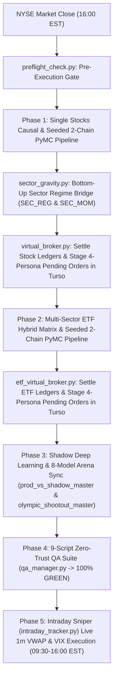

# 🏛️ The ORACLE & AntiGravity: Master Architecture & AI Engineering Reference (`v2.5-Deterministic-Lineage`)
*Last Updated: October 30, 2026*

This document is the definitive technical manual for **The ORACLE (AntiGravity)** quantitative trading system. It details the cloud-native **Vultr + Prefect 3** pipeline, the **100% Turso Cloud SSOT** database schema, the mathematical interlock between Single Stocks and Multi-Sector ETFs, the 7-stage deterministic lineage engine (`oracle_lineage_core.py` & `trace_decision.py`), and all 8 competing models in the Unified Arena.

---

## 1. 🔄 Master Daily Execution & Intraday Lifecycle



---

## 2. ☁️ Authoritative Turso Cloud Database Schema (100% SSOT)

| Table Name | Primary Key | Purpose & Mathematical Role |
| :--- | :--- | :--- |
| `yahoo_daily_prices` | `(ticker, date)` | Raw OHLCV market bars for all S&P 500 VIP stocks, ETFs, and benchmarks (`SPY`, `QQQ`). |
| `etf_scorecards_master` | `(date, persona, ticker)` | Unified scorecard table storing $P(\text{UP})$, $\mathbb{E}[R]$, $\sigma_{\text{SV}}$, `kelly_allocation`, and `recommendation` for all 8 Stock & ETF personas. |
| `feature_lineage_audit` | `(ticker, target_date, asset_class)` | Stores Stage 2–4 lineage: selected lag, OOS accuracy, raw features, training mean/std ($X_m, X_s$), Z-scored vector ($Z$), deterministic MCMC seeds (`sv_seed`, `main_seed`), posterior outputs, and SHA-256 snapshot hash. |
| `decision_lineage_audit` | `(ticker, target_date, persona)` | Stores Stage 5 lineage: $P(\text{UP})$, $\mathbb{E}[R]$, $\sigma_{\text{SV}}$, Sharpe, `raw_kelly`, `kelly_multiplier`, `vix_multiplier`, `applied_kelly`, `recommendation`, and `reason_code`. |
| `pending_orders` | `(persona)` | Stages pre-market and active intraday target cash, equity, and integer share holdings (`target_holdings_json`) + Sniper execution memory (`executed_intraday_trades_json`). |
| `capital_ledgers` | `(persona, date)` | Double-entry daily ledger across all 8 personas from exact `$10,000.00` inception (`cash`, `total_equity`, `holdings_json`, `daily_pnl_json`, `intraday_status`, `engine_version`). |
| `prod_vs_shadow_master` | `(date, model_name)` | Tracks the 6 model architectures (`PROD_Bayesian_SV`, `Shadow_Transformer`, `Sandbox_V1`, `Shadow_LSTM`, `Shadow_ETF_Whale`, `Shadow_Neural_Safety`) normalized to `$10,000.00` inception. |
| `olympic_shootout_master` | `(date, model_name)` | Tracks the 3 universe portfolios (`CHAMPION (Live VIP)`, `EL_CAP (70% Liquidity)`, `EL_VOLTI (70% Stability)`) normalized to `$10,000.00` inception. |
| `process_continuity` | `(pipeline_name)` | Enforces strict sequencing between `master_pipeline` (Single Stocks) and `etf_pipeline` (ETFs). |

---

## 3. 🧬 Seeded 2-Chain Bayesian PyMC SV + Dual-Head Engine & Bounded Kelly Sizing

### 3.1 Deterministic Seeding (`oracle_lineage_core.deterministic_mcmc_seed`)
To guarantee 100% reproducible MCMC inference without random drift:
$$\text{Seed} = \text{int}\left(\text{SHA256}(\texttt{"ORACLE\_MCMC\_V1|"} \parallel \text{ticker} \parallel \texttt{"|"} \parallel \text{target\_date} \parallel \texttt{"|"} \parallel \text{stage})[:8], 16\right) \bmod (2^{31} - 1)$$

### 3.2 Stochastic Volatility + Dual-Head Specification
1. **Stage A — Latent Stochastic Volatility (`SV`):**
   - $\sigma_{\text{step}} \sim \text{Exponential}(10.0)$, $s_t \sim \text{GaussianRandomWalk}(\sigma = \sigma_{\text{step}})$, $\nu_{\text{sv}} \sim \text{Exponential}(0.1) + 2.0$.
   - Projects tomorrow's localized volatility $\sigma_{\text{SV}} = \mathbb{E}[\exp(-s_T)]$.
2. **Stage B — Dual-Head Direction & Magnitude (`MAIN`):**
   - **Logistic Direction Head:** $\alpha_{\text{dir}} \sim \mathcal{N}(\mu_0, 0.5)$, $\beta_{\text{dir}} \sim \mathcal{N}(0, 1)$, $p_t = \text{sigmoid}(\alpha_{\text{dir}} + X_t \beta_{\text{dir}})$.
   - **Student-T Magnitude Head:** $\alpha_{\text{mag}} \sim \mathcal{N}(0, 0.5)$, $\beta_{\text{mag}} \sim \mathcal{N}(0, 1)$, $\sigma_{\text{mag}} \sim \text{HalfNormal}(0.5)$, $\nu_{\text{mag}} \sim \text{Gamma}(2, 0.1) + 2.0$.
   - **Held-Out Target Posteriors:** $P(\text{UP}) = \mathbb{E}[\text{sigmoid}(\alpha_{\text{dir}} + Z_{\text{target}} \beta_{\text{dir}})]$, $\mathbb{E}[R] = \mathbb{E}[\alpha_{\text{mag}} + Z_{\text{target}} \beta_{\text{mag}}]$.

### 3.3 Bounded Fractional Kelly & 8-Persona Gate (`oracle_lineage_core.evaluate_persona_decision`)
Because Bayesian shrinkage shrinks single-day $\mathbb{E}[R]$ toward $+0.10\%\text{–}+0.40\%$ while single-day $\sigma_{\text{SV}} \approx 1.0\%\text{–}1.5\%$, an unadjusted $R = \mathbb{E}[R]/\sigma_{\text{SV}} \approx 0.20$ would require $P(\text{UP}) > 83\%$ for raw Kelly to be positive. To prevent portfolio flatlining when $P(\text{UP})$ and $\mathbb{E}[R] > 0$ pass the persona's conviction gates:
$$R_{\text{eff}} = \max\left(1.0, \, \frac{\mathbb{E}[R]}{\sigma_{\text{SV}}}\right) \quad (\text{when } \mathbb{E}[R] > 0)$$
$$f_{\text{raw}} = \max\left(0.0, \, P(\text{UP}) - \frac{1.0 - P(\text{UP})}{R_{\text{eff}}}\right), \quad f_{\text{applied}} = \min\left(0.25, \, f_{\text{raw}} \times k_{\text{persona}} \times m_{\text{VIX}}\right)$$

---

## 4. ⚔️ Unified Performance Arena: All 8 Models & Benchmarks (`$10,000.00` Inception)

| Box # | Model / Universe Name | Turso Key | Core Mathematical Mechanism | Reconciled Equity (`2026-10-30`) |
| :---: | :--- | :--- | :--- | :---: |
| **1** | **Prod (`BallsForBrains`)** | `PROD_Bayesian_SV` | Live Single-Stock Seeded 2-Chain PyMC SV + Dual-Head + Intraday VWAP Sniper (`k=0.90`) | **`$10,176.36`** (`+1.76%`) |
| **2** | **EL_CAP (70% Liquidity)** | `EL_CAP (70% Liquidity)` | Olympic Universe weighted 70% Dollar Volume Liquidity / 30% Inverse Volatility | **`$9,958.37`** (`-0.42%`) |
| **3** | **EL_VOLTI (70% Stability)** | `EL_VOLTI (70% Stability)` | Olympic Universe weighted 70% Inverse Volatility Stability / 30% Liquidity | **`$9,986.93`** (`-0.13%`) |
| **4** | **Shadow Transformer** | `Shadow_Transformer` | 4-Head Self-Attention Deep Learning Sequence Model (`d_model=64`) | **`$9,930.62`** (`-0.69%`) |
| **5** | **Sandbox V1 Classic** | `Sandbox_V1` | 100-Tree Random Forest Baseline (`max_depth=4`) | **`$9,981.03`** (`-0.19%`) |
| **6** | **Shadow LSTM** | `Shadow_LSTM` | 2-Layer Bidirectional LSTM Recurrent Network (`64` hidden units) | **`$9,936.93`** (`-0.63%`) |
| **7** | **Shadow ETF Whale (Task #1)** | `Shadow_ETF_Whale` | Live Multi-Sector ETF `ETF_BallsForBrains` with S&P 500 Whale Fundamental Priors (`k=0.75`) | **`$10,349.02`** (`+3.49%` 👑) |
| **8** | **Shadow Neural Safety (Task #2)** | `Shadow_Neural_Safety` | Capital-Preservation `Conservative` Stock Engine with VIX-Adaptive Stops (`k=0.25`) | **`$10,020.46`** (`+0.20%`) |

---

## 5. 🔍 Deterministic 7-Stage Audit Command (`trace_decision.py`)
To verify any historical or live prediction and its exact realized dollar PnL impact in **Turso**:
```bash
py c:\Users\AviShemla\AntiGravity\trace_decision.py --date 2026-10-29 --ticker XLC --persona ETF_BallsForBrains
py c:\Users\AviShemla\AntiGravity\trace_decision.py --date 2026-10-29 --ticker NDAQ --persona BallsForBrains
```
Or query the live REST endpoint directly:
```text
GET http://66.42.118.26:80/api/trace?ticker=XLC&date=2026-10-29&persona=ETF_BallsForBrains
```
